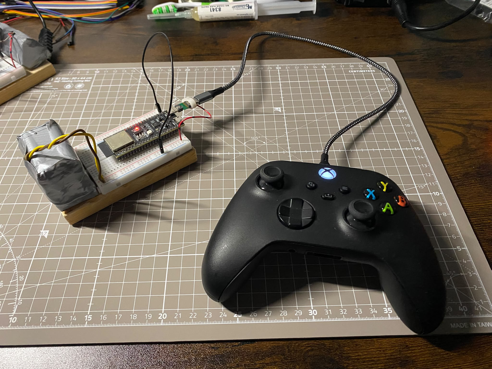
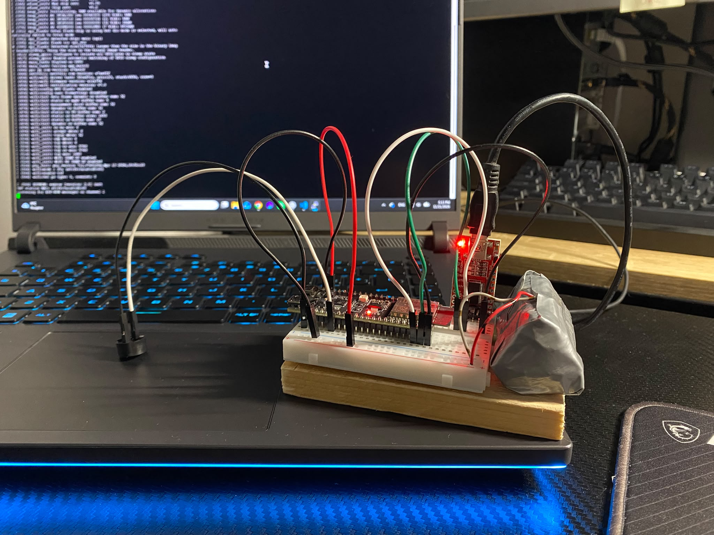
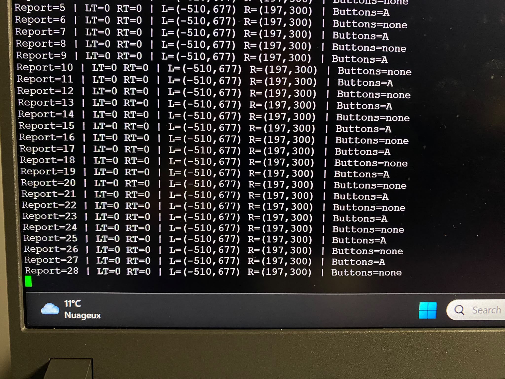

# Xbox Controller → ESP-NOW → UAV

Two ESP32-S3 boards relay wired Xbox controller inputs over ESP-NOW. The receiver prints the reports and drives a buzzer while **A** is pressed. This is a UAV communication bench-test prototype, not flight-control firmware.

```text
Xbox controller ──USB──▶ ESP32-S3 ──ESP-NOW──▶ UAV ESP32-S3
                        Read · Decode · Send   ├── Serial console
                                               └── Buzzer (button A)
```

## Repository structure

| Folder | Firmware role |
| --- | --- |
| [XBOX-Controller_Side](./XBOX-Controller_Side/README.md) | Initializes the USB controller, validates reports, decodes inputs, and sends text over ESP-NOW. Handles USB disconnection and transfer cleanup. |
| [UAV_Side](./UAV_Side/README.md) | Receives reports through a 10-message FreeRTOS queue, prints them, and enables 1 kHz, 50% duty-cycle PWM on GPIO47 when A is reported as pressed. |

Each folder is a standalone ESP-IDF project with application logic in `main/main.c`. Follow the links for firmware details, wiring, and bench photos.

## Hardware and configuration

- **Two ESP32-S3 boards**, with access to native USB Host on the transmitter.
- **Wired Xbox controller** with USB VID/PID `045E:0B12`, a suitable data cable/host adapter, and controller power supply. Other controller variants require firmware changes.
- **Buzzer output on GPIO47** of the receiver; UART0 serial consoles run at **115200 baud**.
- **ESP-IDF 6.1.0** is recorded in the current configuration; the transmitter lockfile also records `espressif/usb` **1.6.1**.

Both boards use Wi-Fi channel **1**, with power saving disabled. Reports are sent directly to the configured receiver MAC without encryption or a router.

## Bench setup

**Controller side** — Wired Xbox controller connected to the ESP32-S3 USB Host interface.



**UAV side** — Battery-powered ESP32-S3 receiver, buzzer, and USB-to-UART bridge.



**Received reports** — Controller inputs displayed in PuTTY over UART0 at 115200 baud.



## Quick start

1. Open an ESP-IDF terminal. Build and flash `UAV_Side`, then note the **UAV station MAC** printed in the serial monitor.
2. Set `receiver_mac` in `XBOX-Controller_Side/main/main.c` to that address. Keep `ESPNOW_CHANNEL` identical on both boards, currently `1`.
3. Build and flash `XBOX-Controller_Side`, then connect the controller to its USB Host interface.
4. Check reports on the receiver's console. Press **A** to enable the buzzer and release it to disable the output on the next report.

Run these commands inside each firmware folder, replacing `COM_PORT` with the board's serial port.

```sh
idf.py build
idf.py -p COM_PORT flash monitor
```

## Message format

```text
Report=12 | LT=0 RT=0 | L=(0,0) R=(0,0) | Buttons=A,LB
```

Each accepted USB input report produces a newline-terminated text payload. `Report` is the controller's sequence byte; triggers are raw unsigned values, sticks are raw signed `(X,Y)` values, and `Buttons` lists pressed buttons or `none`. No dead zones or normalization are applied.

## Current limitations

**No link-loss timeout is implemented: the buzzer retains its last state if reports stop.** The receiver does not filter sender MAC addresses and drops new reports if its queue is full. Flight control and application-level delivery acknowledgments are not implemented; range, latency, and reliability measurements are not documented.
