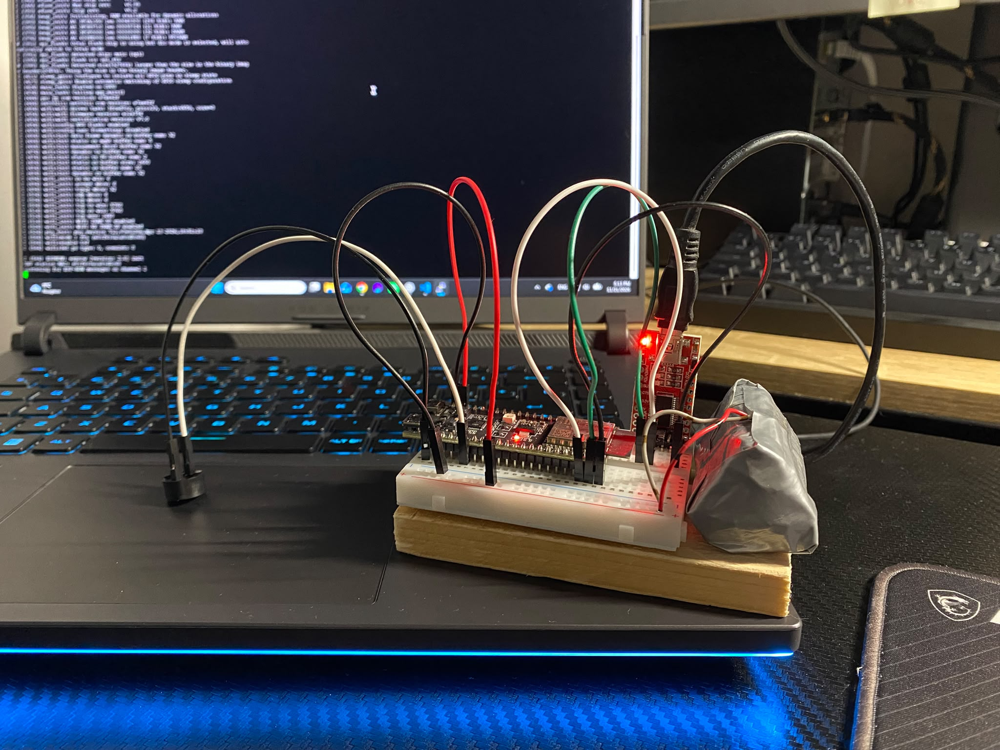
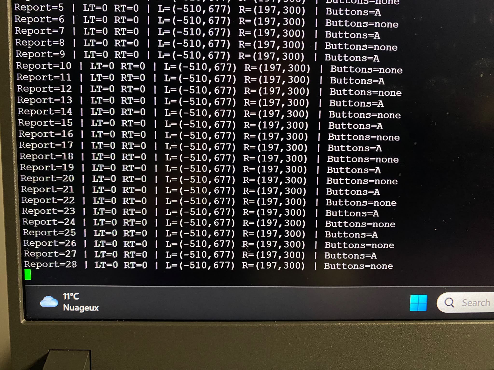

# UAV-Side ESP-NOW Receiver

ESP-IDF firmware for an ESP32-S3 that receives controller reports over ESP-NOW, prints them to the serial console, and controls a buzzer through PWM on GPIO47.

The companion [Xbox-controller transmitter](../XBOX-Controller_Side/) reads a wired Xbox controller over USB and sends its button, trigger, and joystick states. No router is required.

## Behavior

- Receives text reports on Wi-Fi channel **1** with Wi-Fi power saving disabled.
- Enables **1 kHz PWM at 50% duty cycle** when the received `Buttons=` list contains `A`; otherwise, GPIO47 is held low. The output starts low.
- Copies incoming reports into a **10-message FreeRTOS queue**. The main loop processes each report, updates the buzzer, and prints the text.
- Accepts payloads of **1–249 bytes**. New reports are dropped if the queue is full.

Example report:

```text
Report=12 | LT=0 RT=0 | L=(0,0) R=(0,0) | Buttons=A,LB
```

Only the button list is interpreted for buzzer control; other fields are printed as received.

## Hardware and configuration

The bench setup uses an ESP32-S3 receiver board with a buzzer connected directly to GPIO47, plus a second board running the companion transmitter firmware. The controller connects to the transmitter's USB Host interface.

| Setting | Current value |
| --- | --- |
| Framework | ESP-IDF; current configuration generated with v6.1.0 |
| Target | ESP32-S3 |
| Radio channel | `ESPNOW_CHANNEL = 1` |
| Serial baud rate | 115200 |
| CPU / main crystal | 160 MHz / 40 MHz |
| PWM output | GPIO47, LEDC channel 0, timer 0, low-speed mode |
| PWM frequency / resolution | 1 kHz / 10 bits (1024 counts) |
| PWM clock selection | `LEDC_AUTO_CLK`; current ESP-IDF driver selects APB at 80 MHz |

The LEDC driver calculates the PWM divider automatically: `80,000,000 / (1000 × 1024) = 78.125`. Clock and target settings are in `sdkconfig`; radio and PWM settings are in [main/main.c](main/main.c).

## Build and use

1. Open an ESP-IDF-enabled terminal in this project folder and build:

   ```sh
   idf.py build
   ```

2. Flash and open the serial monitor, replacing `COM_PORT` with the receiver's port:

   ```sh
   idf.py -p COM_PORT flash monitor
   ```

3. Read the **UAV station MAC** printed at startup. Set the transmitter's `receiver_mac` to that address and ensure both boards use the same ESP-NOW channel. Rebuild and flash the transmitter if needed.
4. Send controller reports. Check that they appear in the receiver console. Press **A** to enable the buzzer PWM and release it to disable the output on the next report.

## Bench test

The receiver setup is powered by a custom battery pack containing **three 1.5 V alkaline cells in series**, providing approximately **4.5 V** to the board's supply input. The buzzer is driven directly from GPIO47 by the firmware's **1 kHz, 50% duty-cycle PWM** when button A is reported as pressed.



Received ESP-NOW reports are printed through **UART0**. An **FTDI FT232 USB-to-UART bridge** connects the board's UART0 pins to the PC, where **PuTTY** displays the reports at **115200 baud, 8 data bits, no parity, 1 stop bit, and no flow control**. The photo below shows reports alternating between `Buttons=A` and `Buttons=none`.



## Code structure

All application logic is in [main/main.c](main/main.c):

- `pwm_init()` and `buzzer_set()`: configure LEDC and switch the output duty cycle.
- `a_button_pressed()`: find button `A` in the comma-separated button list.
- `receive_callback()` and `wireless_init()`: queue incoming messages and initialize Wi-Fi/ESP-NOW.
- `app_main()`: initialize the application, print connection information, and process queued reports.

## Limitations

This is a communication and buzzer bench test, not flight-control firmware. **There is no link-loss timeout: the buzzer retains its last state if reports stop.** The receiver does not filter sender MAC addresses or configure encrypted peers. Hardware performance, range, and latency are not documented as measured results.

