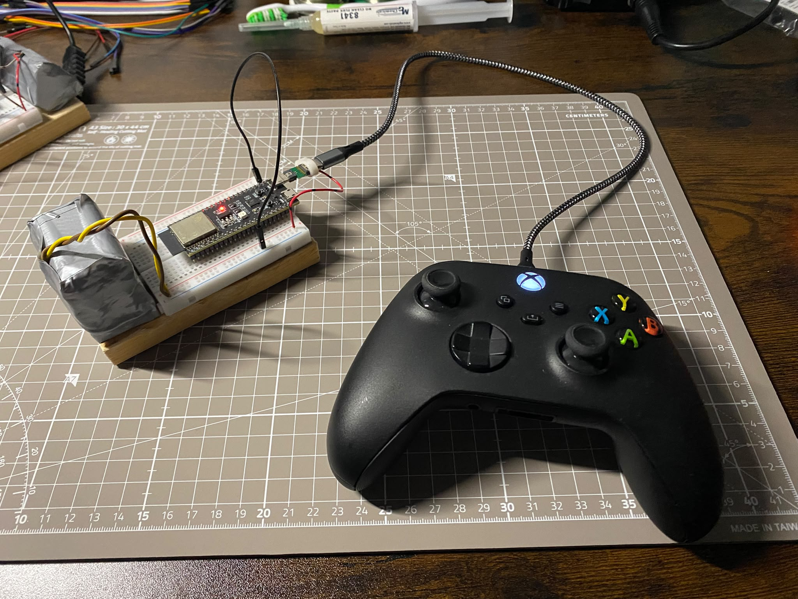

# Xbox Controller → ESP-NOW

ESP32-S3 firmware that reads a wired Xbox controller over USB and forwards its buttons, triggers, and joystick positions to another ESP32 using ESP-NOW. This is the controller-side firmware of the UAV project; receiver firmware is maintained separately.

```text
Xbox controller ──USB──▶ ESP32-S3 ──ESP-NOW──▶ Receiving ESP32
                        Read · Decode · Send
```

## Features

- Detects the supported controller and sends its startup commands.
- Validates incoming USB reports before decoding controller inputs.
- Sends readable text messages directly to a configured receiver, without a router.
- Handles USB disconnection and releases transfers and the claimed interface.
- Uses separate FreeRTOS tasks for USB host events and controller communication.

## Bench-test setup



The current bench setup connects the controller's USB-C cable to the ESP32-S3 through USB-C-to-micro-USB adapter PCBs. The red wire feeds the controller's USB VBUS (5 V power line) directly at the adapter because the board's diode prevents power from reaching it through the normal USB path.

The setup uses six 1.5 V alkaline cells arranged as **3S2P** (three in series, two strings in parallel), giving **4.5 V nominal**. The ESP32-S3 reads controller inputs over USB and forwards them to the receiver using **ESP-NOW over the 2.4 GHz Wi-Fi radio**.

## Hardware and configuration

You need an ESP32-S3 board with access to its native USB host interface, a suitable USB data cable/host adapter and controller power supply, a compatible Xbox controller, and an ESP-NOW receiver.

The current settings are defined in [main/main.c](main/main.c):

| Setting | Value |
| --- | --- |
| Controller USB VID / PID | `0x045E` / `0x0B12` |
| USB interface / alternate setting | `0` / `0` |
| USB endpoints | IN `0x82`, OUT `0x02` |
| Accepted input report | 48 bytes: `20 00 <sequence> 2C …` |
| ESP-NOW channel | `1` (`ESPNOW_CHANNEL`) |
| Receiver MAC | `E8:F6:0A:A8:D5:68` (`receiver_mac`) |
| ESP-NOW encryption | Disabled |
| Wi-Fi power saving | Disabled |

Update `receiver_mac` to match your receiver's Wi-Fi station MAC, and configure both boards on the same channel. Controller IDs, endpoints, and report layout are hard-coded; other controller variants require adaptation.

## Build and run

The committed [dependency lockfile](dependencies.lock) records **ESP-IDF 6.1.0** and **espressif/usb 1.6.1**, targeting **ESP32-S3**.

1. Open an ESP-IDF terminal in this project directory.
2. Update the receiver settings in `main/main.c`.
3. Build, flash, and open the serial monitor:

   ```sh
   idf.py build
   idf.py -p PORT flash monitor
   ```

   Replace `PORT` with the board's serial port, for example `COM5`. The committed `sdkconfig` already selects `esp32s3`; the UART0 console runs at **115200 baud**.

4. Start the receiver firmware on the second board, then connect the controller to the transmitter's native USB host interface. Check for `USB client ready` and the matching VID/PID in the logs.
5. Move the sticks, operate the triggers, and press buttons. Verify that matching messages appear at the receiver. Exit the ESP-IDF monitor with `Ctrl+]`.

## Message format

Each accepted input report produces a text payload such as:

```text
Report=12 | LT=0 RT=0 | L=(0,0) R=(0,0) | Buttons=A,LB
```

| Field | Meaning |
| --- | --- |
| `Report` | Controller report sequence byte |
| `LT`, `RT` | Raw unsigned trigger values |
| `L`, `R` | Raw signed joystick `(X,Y)` values, without dead zones or normalization |
| `Buttons` | Comma-separated pressed buttons, or `none` |

Supported buttons: `A`, `B`, `X`, `Y`, `Menu`, `View`, `Up`, `Down`, `Left`, `Right`, `LB`, `RB`, `LClick`, `RClick`.

Payloads end with a newline and exclude the terminating C null byte. The receiver must use the received payload length when reading the message.

## Firmware structure

All application logic is in [main/main.c](main/main.c):

| Function | Responsibility |
| --- | --- |
| `app_main()` / `wireless_init()` | Initialize wireless communication and start the USB host task. |
| `usb_host_task()` | Install the USB Host library, register a client, start the client task, and service host events. |
| `usb_client_task()` | Open detected devices, check controller IDs, run capture, and close the device afterward. |
| `read_xbox_packets()` | Send startup commands, reuse USB transfers, validate reports, and clean up after capture. |
| USB callbacks | Record device events and mark transfers as complete. |
| `send_report()` and decoding helpers | Extract input values, format the payload, and submit it to ESP-NOW. |

## Current scope

This is a bench-test prototype for the USB-to-wireless input path. The `ESP-NOW queued` log confirms local submission only; verify reception on the receiving board. Flight control, link-loss failsafes, input calibration, and delivery acknowledgments are not implemented. Latency, range, and reliability measurements are not documented here.
